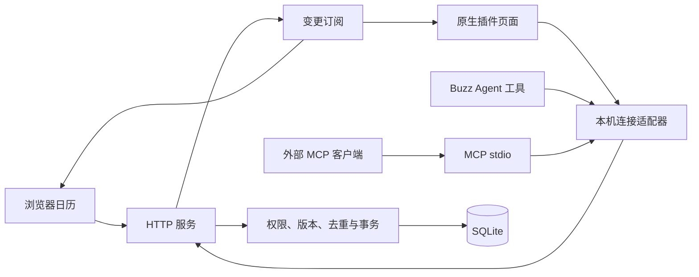

# 框架目标

沿用 1.0.2 已实现的明亮 UI，将日历界面、共享业务与持久化、Buzz 插件、独立 MCP 整理成可独立启动和继续开发的工程。工作区首次不加载示例任务；旧示例完整保留。

# 目录与职责

| 位置 | 当前职责 | 后续扩展位置 |
| --- | --- | --- |
| `src/Calendar.jsx`、`calendar.css` | 日／周／月、筛选、任务、会议、首次使用引导 | 沿用同一界面，不在页面另建数据副本 |
| `server/store.mjs` | 唯一任务身份、写校验、权限、版本、操作回执、SQLite 事务 | 接真实任务来源时保留稳定的 sourceKey/sourceId |
| `server/main.mjs` | 同源 HTTP、页面、变更事件 | 团队部署需增加统一身份与 HTTPS，当前仅回环地址 |
| `server/runtime.mjs` | 工作区／示例目录、端口、连接路径、版本 | UI 连接器与 MCP 一致解析 |
| `src/plugin.jsx`、`server/client.mjs`、`events.mjs` | Buzz 页面、受限工具与变更订阅 | 原生安装后验证页面与工具，当前授权范围不扩大 |
| `server/mcp.mjs`、`src/tools.mjs` | 独立 MCP stdio 与共同工具定义 | 由 Agent 解析自然语言，提交结构化周／日计划 |
| `scripts/` | 可复现构建与本机插件路径配置 | 构建只依赖本工程 package-lock.json |
| `tests/` | 数据、HTTP、MCP、插件与工作区隔离验证 | 每次代码修改运行完整包测试 |

# 启动与模式

在 `calendar/` 目录执行：

| 用途 | 命令 | 数据与地址 |
| --- | --- | --- |
| 工作区 | `npm start` | `.runtime/workspace/`，端口 4177；首次无任务 |
| 原示例 | `npm run start:demo` | `.runtime/`，端口 4176；保留已有数据 |
| 生成工作区插件配置 | `npm run setup` | `plugin/manifest.json` 明确指向工作区 |
| 工作区 MCP | `node server/mcp.mjs --workspace` | 读取工作区 client.json |
| 示例 MCP | `node server/mcp.mjs --demo` | 读取原示例 client.json |

入口支持 `CALENDAR_PROFILE`、`CALENDAR_PORT`、`CALENDAR_DATA_DIR`；客户端支持 `CALENDAR_CONFIG` 或 `--config /absolute/path/client.json`。`--workspace`／`--demo` 优先于环境模式；显式 `--config` 优先于环境连接路径。自定义数据目录时，服务启动与 `scripts/setup.mjs` 使用相同的 `CALENDAR_DATA_DIR`；独立 MCP 明确传入相应 client.json。配置文件由服务首次启动产生，包含本机凭据，交付不附带。

新模式只决定全新数据库的初始数据；已有数据库永不自动清空或重置。两份库独立运行，不互相同步。工作区的默认 Moo／团队事务可在管理面板修改，不代表已读取真实成员。

交付包无需安装依赖即可启动；源码构建执行 `npm ci` → `npm run build` → `npm test`。`npm run build` 生成单文件插件和预览，并刷新本目录的插件路径。首次安装仍按 Buzz 宿主要求在管理插件中使用 Browse 审核文件夹；本轮未安装。

# 数据与写入约定

1. `Task.id` 是日历里的唯一身份，`sourceKey + sourceId` 将来源任务稳定映射到它；不同项目也共用成员身份。
2. `Plan.taskIds`、`Allocation.taskId` 引用相同任务。工作跨三天只有三条日期安排，不复制三份任务。
3. UI、Buzz 工具和 MCP 均通过 `store.mutate`；写入必须带 requestId 和 expectedRevision。超时先查操作回执；并发冲突返回 409，不覆盖其他修改。
4. 截止日期单独保留，未排日期进入待安排；会议记录时间、地点、参与者、已有链接和提醒设置。
5. 当前权限是该本机日历的 owner/editor/viewer，不是已完成的团队账号和项目级授权系统。

# 外部接入边界

| 接入项 | 当前状态 | 完成接入需要 |
| --- | --- | --- |
| 任务中心 | 未读写真实数据 | 确认源 ID、权限和写接口，避免复制任务主数据 |
| 团队跨设备 | 未部署 | 共用服务、HTTPS、成员身份及两台真实设备验证 |
| 腾讯会议 | 仅保存已有链接 | 服务端开放平台认证、创建／更新／取消与结果查询 |
| 会议提醒 | 页面开启时提醒 | 关闭页面后的调度与 Buzz／系统投递 |
| Buzz 安装 | 文件夹可构建 | 拥有者审核首次安装，并验证宿主页面和工具 |

后续入口按已确认范围接入，不扩展工时负荷、自动锁定和自动重排。本轮不发出真实会议邀请或团队通知。

依据：当前项目源码；`TEAM_CALENDAR_CONFIRMED_SCOPE_V1_20261116.md`；当前 Buzz 插件 authoring guide；Moo 本轮框架请求：`原开发会话（不随公开包提供）`。
